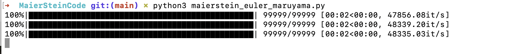
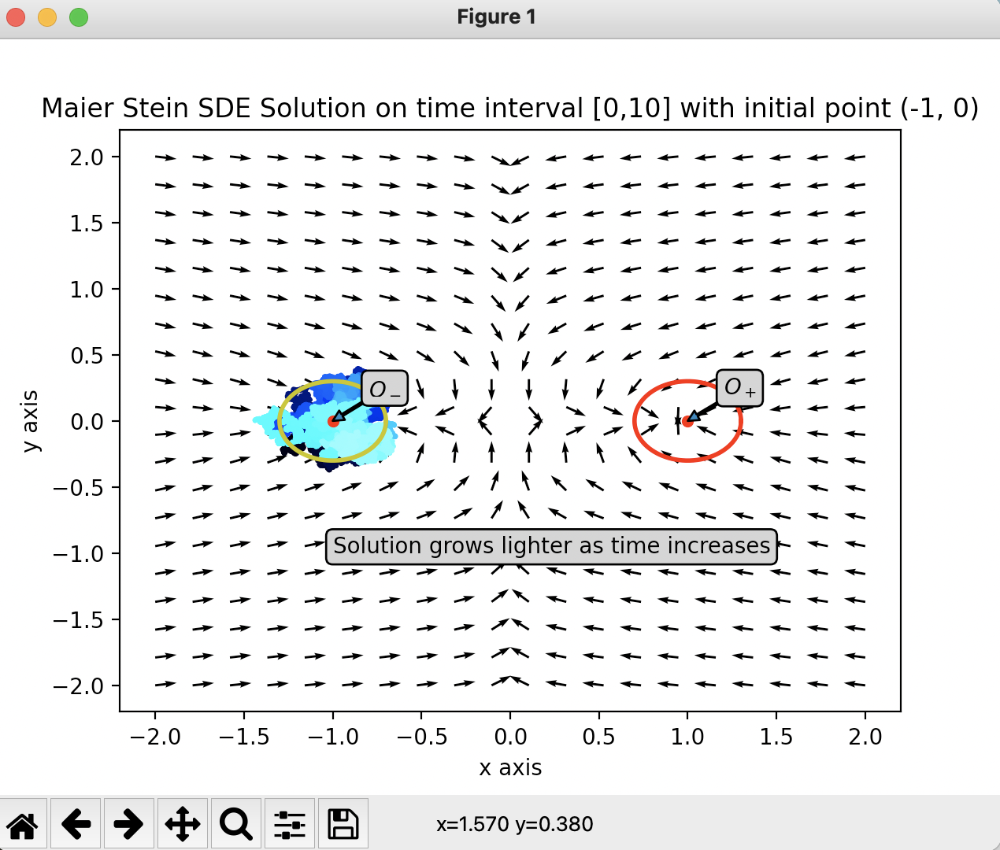
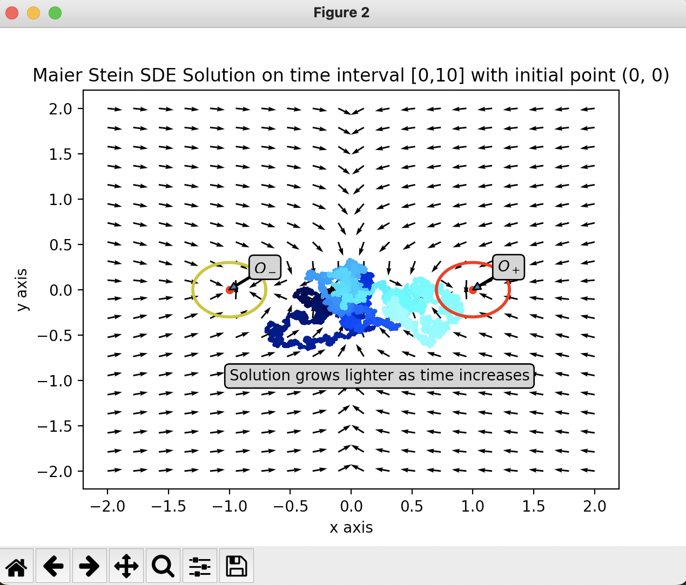
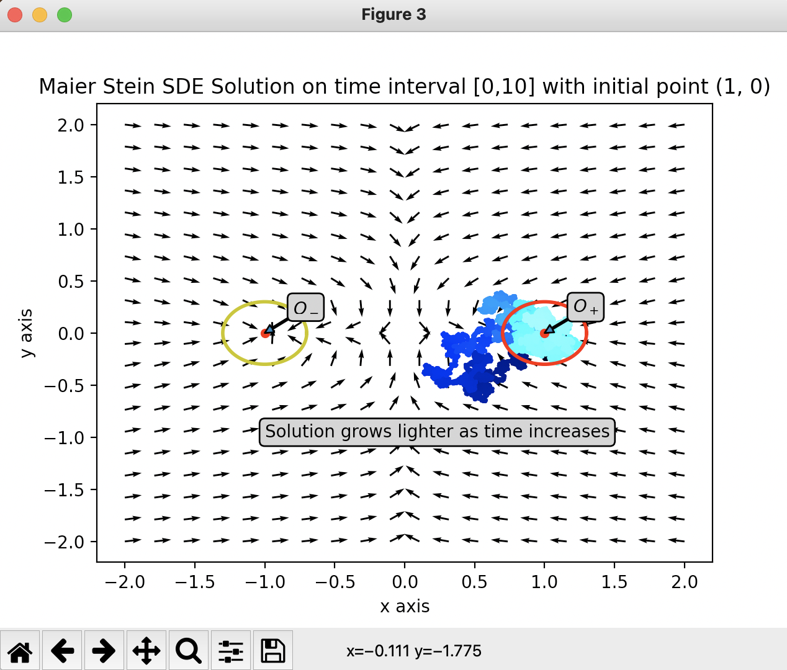

# Neural Network Approach for solving the Maier-Stein Committor problem

This project was done as part of UMD's 2022 math REU on machine learning methods in the study of rare events. 

#### Purpose: 
The Maier-Stein stochastic system is a benchmark 2D system for studying the committor problem. See my write up on my Linkedin for background on the committor problem. The goal of this code is to compare a neural network approach for obtaining a solution, tested against the ground truth finite elements method solution. 

#### Soft description of the method: 
I imagine a neural network as a gentle blanket. The partial differential equation (PDE) is like a rocky surface. Being hard, it defines exact heights to each coordinate on a map. Since solving the committor problem means solving a PDE, the physics informed neural network approach is like laying a blanket down on the rocky surface, pressing it down so that there are as few air bubbles as possible.

#### Quick start instructions (how to install/run)

Installation (cloning the repo locally and setting up the virtual environment):
```bash
1. git clone https://github.com/williamclarktennis/MaierSteinCode.git
2. cd MaierSteinCode
3. python -m venv venv
4. source venv/bin/activate   # Mac/Linux
4b. venv\Scripts\activate      # Windows
5. pip install -r requirements.txt
```

Start out with `testsolvers.py`. When you run this code, you will see

#### approx_images

chiAchiBbdyenforcement.png: Boundary enforcement means ensuring that the neural network takes the value 0 on the boundary of the left sink, and 1 on the boundary of the right sink. (double check that it is not vice versa). chiA and chiB are functions defined in the project write up. They are a smooth approximation to the indicator function. 

#### maierstein_euler_maruyama.py



This script samples and plots three trajectories, differing
by entry point. The sampling method is the Euler-Maruyama
discretization.







